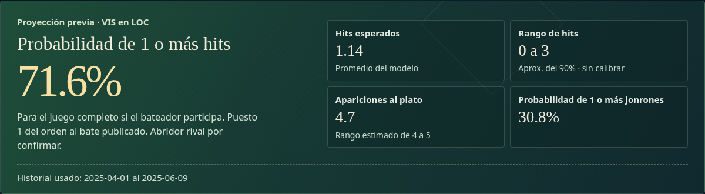

# ⚾ Diamond IQ · Baseball Analyzer 3.0

**El partido, el duelo y una proyección que puedes entender.** Explora la jornada MLB, elige un bateador de la alineación publicada y consulta sus probabilidades de terminar con **0, 1 o 2+ hits**. También puedes analizar su perfil sin seleccionar un partido.

Web adaptable a Mac, iPhone y Android, con servidor local, reportes guardados y PWA instalable. Sin cuenta ni claves de API. Las consultas nuevas requieren Internet y acceso a los proveedores públicos.

[Empezar en Mac](#empezar-en-mac) · [Modo en vivo](#seguir-un-partido-en-vivo) · [Guía de uso](#del-partido-a-la-proyección) · [Cómo calcula](docs/modelo.md) · [Evaluación histórica](docs/evaluacion.md) · [Comprobar conexiones](#comprobar-conexiones) · [Acceso móvil](#iphone-y-android) · [Autor](#autor)

Vista de la interfaz con **datos sintéticos de prueba**, no un pronóstico real de MLB:



[Ver el análisis en móvil](docs/diamond-iq-390.png) · [Ver el marcador móvil con un juego real ya finalizado](docs/marcador-390.png)

## Qué cambia en 3.0

El **modo En vivo** reúne marcador, cuenta, corredores, lanzador y bateador actuales. Muestra la probabilidad de victoria publicada por MLB tras la última aparición completada y estima hits adicionales del bateador bajo escenarios explícitos de oportunidades. Incluye una repetición de un juego real para recorrer un cambio de ventaja.

[Ver el tablero en vivo en móvil](docs/en-vivo-390.png)

## Qué cambió en 2.2

- **Medición por temporadas.** Evalúa una cohorte reproducible y reserva la última temporada para medir la distribución de 0, 1 y 2+ hits. Statcast distingue los juegos de temporada regular, playoffs y pretemporada.
- **Pronóstico frente al resultado.** Cruza los pronósticos guardados antes del primer lanzamiento con los resultados finales de MLB. Compara el error con y sin orden al bate, abridor o bullpen en los mismos juegos.
- **Tarjeta de anotación.** Consulta el marcador por entradas y compara a dos bateadores del mismo equipo. Prueba un abridor alternativo del roster rival. La simulación lleva su propia etiqueta y los pronósticos de la evaluación se conservan aparte.
- **Libreta local.** Filtra reportes por partido, fija los que quieras conservar y exporta una copia JSON que puedes importar en otro navegador. Si cambias la selección durante una consulta, el resultado anterior deja de actualizar la pantalla.
- **Menos espera en consultas simultáneas.** DuckDB lee la ventana de fechas solicitada y los historiales de distintos jugadores pueden actualizarse en paralelo. GitHub Actions comprueba el backend, TypeScript y los flujos de navegador.

En la temporada reservada de 2025, el perfil del bateador obtuvo **2.62% menos error de probabilidad (RPS)** que una referencia de tasa reciente en 1,094 predicciones de 35 jugadores. [Resultados y cómo reproducirlos](docs/evaluacion.md#resultado-de-la-temporada-reservada-2025)

## Qué incluye Diamond IQ

- **Jornada MLB:** fecha, equipos, estadio y pitchers probables; alineación publicada o pendiente, sin confundir roster con titulares.
- **Búsqueda flexible:** `Aaron Judge`, `Judge Aaron` o `Judge`; ignora mayúsculas y acentos, y sugiere coincidencias ante errores pequeños. Siempre debes seleccionar al jugador correcto.
- **Resultados explicados:** distribución de hits, rango predictivo, factores del modelo, fuentes y datos faltantes. Los detalles técnicos quedan disponibles para profundizar.
- **Abridor y relevistas:** separa las apariciones esperadas contra ambos. Usa orden al bate e historial de oportunidades del equipo cuando están disponibles.
- **Contexto del juego:** pronóstico meteorológico, tipo de techo, repertorio del pitcher, edad, días desde el último juego y carga reciente de relevistas. Estos datos descriptivos no añaden coeficientes numéricos sin validar.
- **Más historia local:** selector de hasta diez años, descargas incrementales y archivos Parquet consultados con DuckDB. Statcast se limita a datos disponibles desde 2015.
- **Evaluación ampliada:** hasta 500 juegos por jugador desde la web, en segundo plano; evaluación multijugador por consola y comparación experimental con CatBoost.
- **Uso diario:** favoritos y reportes en IndexedDB; migración de los reportes del navegador de la versión anterior; lanzador para Mac.

La guía de evaluación explica las medidas de precisión y cómo reproducirlas. [Evaluación histórica y seguimiento de pronósticos](docs/evaluacion.md)

## Empezar en Mac

Necesitas **Python 3.10 o posterior**. Compruébalo con `python3 --version`; si no lo tienes, instala Python desde [python.org](https://www.python.org/downloads/macos/).

La primera vez, abre Terminal:

```sh
git clone https://github.com/sebasclarkv/baseball-analyzer.git
cd baseball-analyzer
```

Después abre **Abrir Diamond IQ.command** desde Finder, o ejecútalo en Terminal:

```sh
./"Abrir Diamond IQ.command"
```

El lanzador crea `.venv`, instala las dependencias cuando cambian, espera a que el servidor esté listo y abre el navegador. Mantén Terminal abierto; **Control+C** detiene el servidor. La primera instalación necesita Internet. Si descargaste un ZIP y el archivo no tiene permiso de ejecución: `chmod +x "Abrir Diamond IQ.command"`.

También puedes iniciarlo manualmente en macOS o Linux:

```sh
python3 -m venv .venv
.venv/bin/python -m pip install --disable-pip-version-check -r requirements.txt
.venv/bin/python server.py
```

Abre **http://127.0.0.1:8000**. En Windows, usa `python -m venv .venv` y sustituye `.venv/bin/python` por `.venv\Scripts\python.exe`.

Si ya tienes el repositorio, detén el servidor y actualiza desde su carpeta:

```sh
git pull --ff-only origin main
./"Abrir Diamond IQ.command"
```

Si Git informa cambios locales, consérvalos antes de actualizar. Para cambiar puerto usa `.venv/bin/python server.py --port 8080`; el lanzador usa el puerto 8000.

## Seguir un partido en vivo

1. En **Jornada MLB**, selecciona un partido en curso. El tablero se actualiza cada **15 segundos** mientras se está siguiendo el juego. Puedes pausar y volver a actualizarlo.
2. Lee entrada, cuenta, outs y corredores. El porcentaje de victoria de cada equipo se atribuye a **MLB Stats API** y corresponde a la última aparición completada para la que MLB publicó el dato. El marcador y la cuenta pueden estar más adelantados.
3. Selecciona un bateador que siga en la alineación y solicita la estimación. El tablero separa sus hits oficiales de la probabilidad de registrar **al menos un hit adicional** con 1, 2 o 3 oportunidades. La cifra depende del pitcher usado y de que el bateador tenga esas oportunidades, que pueden no llegar.
4. Revisa la hora del dato. Si cambia el estado del juego, vuelve a calcular para el nuevo turno. La primera consulta de Statcast puede tardar más que la actualización del tablero.

Usa **Ver una jugada de ejemplo** si quieres probarlo sin un partido en curso. La repetición muestra el antes y el después del jonrón de Andrés Giménez en Yankees–Blue Jays del 1 de julio de 2025. La estimación de bateo usa historial anterior al día del juego. [Cómo se calculan los números en vivo](docs/modelo.md#modo-en-vivo)

## Del partido a la proyección

1. **Elige una fecha y un partido.** El calendario muestra el estado publicado por MLB. Solo los partidos que todavía no empiezan pueden usarse para una proyección previa; los anteriores se pueden consultar como contexto.
2. **Elige al bateador.** Una alineación publicada permite seleccionar sus titulares. Si está pendiente, el roster ofrece candidatos y el análisis queda marcado como provisional. La alineación puede cambiar después de la consulta.
3. **Revisa el rival.** Para un partido seleccionado, se usa el abridor probable del equipo contrario cuando MLB lo informa. Sin partido, puedes buscar un pitcher manualmente o dejar ese campo vacío.
4. **Ajusta el historial si lo necesitas.** Los juegos recientes describen la forma; el historial largo estabiliza la estimación. Más años no hacen que cada juego antiguo tenga el mismo peso que uno reciente.
5. **Inicia el análisis.** La primera consulta puede tardar al descargar el historial. Las siguientes reutilizan datos locales y descargan los periodos que falten.
6. **Lee el resumen y sus condiciones.** Revisa 0, 1 y 2+ hits, rango de resultados, oportunidades contra abridor/relevistas y datos pendientes. Puedes abrir los detalles técnicos y ejecutar la evaluación histórica.
7. **Abre la libreta.** Fija reportes, filtra por partido o exporta un respaldo local. Puedes importarlo desde otro dispositivo. Un reporte conserva su fecha y las opciones usadas para calcularlo.

**Sin partido:** busca por nombre y apellido —en cualquiera de los dos órdenes— o por apellido, y selecciona una coincidencia. Por ejemplo, `Aaron Judge`, `Judge Aaron` o `Judge`. Las sugerencias aproximadas no corrigen automáticamente la identidad; comprueba el nombre de la lista. El perfil resultante no supone una alineación confirmada.

## Entender los números

| Lectura | Significado |
|---|---|
| Probabilidad de al menos un hit | Qué tan probable es terminar el juego con uno o más hits bajo el escenario analizado |
| 0, 1 y 2+ hits | Resultados excluyentes cuyas probabilidades suman 100%, salvo redondeo visual |
| Hits esperados | Promedio de la distribución; **1.2** no significa que el resultado exacto sea uno |
| Rango predictivo del 90% | Rango aproximado de resultados enteros; su cobertura real todavía requiere evaluación |
| Muestra disponible | Cantidad de evidencia histórica; no equivale a precisión demostrada |
| Provisional / datos pendientes | Información incompleta sobre el partido, titularidad o rival |

Ejemplo ilustrativo: una probabilidad del **67%** de al menos un hit también implica un **33%** de ningún hit. Ninguna de esas cifras elimina la variación propia del juego.

Los ajustes actuales y sus supuestos están documentados en [Cómo calcula el modelo](docs/modelo.md). Los factores descriptivos —clima, parque, repertorio, edad y carga reciente— se identifican como contexto; no se presentan como mejoras de precisión ya demostradas.

## Datos y tecnologías

| Fuente | Uso | Acceso |
|---|---|---|
| MLB Stats API | Jornada, alineaciones, marcador y jugadas en vivo, probabilidad de victoria publicada e históricos de equipo/pitching | Acceso público habitual sin clave; puede cambiar o fallar |
| Baseball Savant / Statcast, mediante pybaseball | Historial de lanzamientos, xBA y calidad de contacto | Consulta pública y caché local |
| Chadwick Bureau | Identidad y búsqueda de jugadores | Registro público mediante pybaseball |
| Open-Meteo | Pronóstico horario cerca del inicio del partido | Modalidad gratuita para uso no comercial, sujeta a sus [condiciones](https://open-meteo.com/en/pricing) |

**Backend:** Python, FastAPI, pandas, NumPy, DuckDB y Parquet. **Interfaz:** HTML, CSS, JavaScript, cliente API tipado en TypeScript y PWA; el usuario final no necesita Node.js. **Investigación opcional:** CatBoost y scikit-learn en CPU, con calibración y cortes temporales. No se requiere un servicio de IA de pago.

Si una fuente falla, se indican los datos ausentes o la antigüedad de la caché. Una caché parcial de Statcast no se anuncia como un historial completo. Retrosheet queda como fuente futura: esta versión no importa sus archivos ni mezcla épocas históricas con mediciones Statcast inexistentes.

## Comprobar conexiones

Después de instalar las dependencias, ejecuta desde la carpeta del proyecto:

```sh
.venv/bin/python scripts/check_connections.py
```

No necesitas iniciar el servidor. El diagnóstico consulta las fuentes por HTTPS y comprueba que sus respuestas funcionen con los adaptadores del analizador:

- **MLB:** jornada histórica, contexto del partido, rosters e historial de oportunidades del equipo.
- **Statcast:** descarga una semana de Aaron Judge mediante pybaseball, comprueba jugador y fechas, guarda en Parquet temporal y calcula la distribución de hits.
- **Chadwick:** descarga el registro y verifica la búsqueda `Judge Aaron` con el buscador de la app.
- **Open-Meteo:** obtiene temperatura y viento para mañana en las coordenadas de Yankee Stadium.

Cada ejecución exige solicitudes de red: no acepta la caché de la app ni la de pybaseball como prueba de conexión. Conserva tus historiales y guarda el diagnóstico en **`.cache/connection-report.json`**, con hora UTC, proveedor, estado HTTP y duración. Ese archivo no se publica en GitHub. Una conexión válida no demuestra precisión predictiva.

| Resultado | Qué significa y qué hacer |
|---|---|
| `passed` | Llegaron datos utilizables y pasó la comprobación del adaptador |
| `blocked` | El proxy rechazó la conexión; revisa los dominios permitidos del entorno |
| `failed` | Falló HTTP, el tiempo de espera, el formato o el procesamiento; consulta el motivo en el reporte |
| `partial` | Hubo alguna solicitud fallida; no cuenta como validación completa |
| `skipped` | Una comprobación previa falló; no se intentó la dependiente |

El comando termina con código **0** solo si todas las comprobaciones pasan; en otro caso devuelve **1**. La muestra predeterminada abarca del 1 al 7 de julio de 2025. Puedes cambiarla por otra semana histórica con juegos de Aaron Judge usando `--sample-date AAAA-MM-DD`, o ajustar el tiempo de espera por solicitud con `--timeout 45`. Un `429` significa límite del proveedor: respeta `Retry-After` antes de repetir.

En un entorno cloud con red restringida, permite **`statsapi.mlb.com`**, **`baseballsavant.mlb.com`**, **`api.open-meteo.com`**, **`github.com`** y **`codeload.github.com`**. Guardar un borrador de configuración no activa esos permisos: debes guardar y publicar la configuración desde los ajustes del entorno y volver a ejecutar el diagnóstico cuando esté aplicada. No necesitas claves de API ni desactivar la verificación TLS.

## iPhone y Android

1. Conecta la Mac y el móvil a la misma Wi-Fi.
2. Inicia el servidor con `.venv/bin/python server.py --host 0.0.0.0`.
3. Obtén la IP privada de la Mac con `ipconfig getifaddr en0` —o consulta Ajustes del Sistema → Wi-Fi → Detalles—.
4. Abre `http://IP-DE-TU-MAC:8000` en Safari o Chrome. Ejemplo: `http://192.168.1.24:8000`.

La Mac debe permanecer encendida y el servidor activo. El servidor no incluye inicio de sesión: úsalo dentro de una red privada confiable y no abras el puerto en el router. Fuera de esa Wi-Fi, puedes usar una VPN privada como Tailscale, enlazando el servidor a su IP privada.

Para instalar la PWA y habilitar su caché offline se necesita **HTTPS**, salvo `localhost` en la propia computadora. Una IP LAN con HTTP sirve la web, pero no habilita esas capacidades de PWA. En iOS: Safari → Compartir → Añadir a pantalla de inicio. En Android: menú de Chrome → Instalar aplicación.

La PWA puede abrir la interfaz y reportes ya guardados sin conexión cuando su caché esté disponible. Generar análisis nuevos requiere servidor y acceso a los datos.

## Evaluación y desarrollo

Consulta [la guía de evaluación](docs/evaluacion.md) para reproducir la cohorte, cruzar pronósticos con resultados de MLB y comparar el candidato CatBoost. Los reportes locales se sirven en `/api/evaluation` y `/api/evaluation/prospective`.

```sh
.venv/bin/python -m pip install -r requirements-dev.txt
.venv/bin/python -m playwright install chromium webkit
.venv/bin/python -m pytest tests -q
.venv/bin/python server.py --reload
```

Para modificar el cliente API TypeScript (opcional; no se necesita para ejecutar la app):

```sh
npm ci
npm run check:frontend
npm run build:frontend
```

`frontend/api.ts` genera `baseball_analyzer_v2/static/api.js`, que se incluye en el repositorio y en la caché PWA.

La documentación de la API está en **http://127.0.0.1:8000/docs**. El frontend se sirve desde el mismo servidor; no utiliza CDN. El programa Tkinter original sigue en `baseball_analyzer.py`.

## Autor

**Sebastian Clark** · [GitHub: @sebasclarkv](https://github.com/sebasclarkv) · [X: @sebasclarkv](https://x.com/sebasclarkv)

## Contribuciones

Las mejoras del modelo, accesibilidad, rendimiento y fuentes de datos son bienvenidas. Haz un fork, crea una rama y abre un Pull Request explicando el cambio y su validación. Para cambios estadísticos, incluye el periodo evaluado, la referencia de comparación y los datos disponibles antes de cada juego.

## Privacidad, agradecimientos y licencia

No hay cuenta ni analítica de uso. La información se procesa en el servidor local; reportes y favoritos del navegador se guardan en IndexedDB. La caché, historiales y archivo de pronósticos viven en `.cache/diamond/`; puedes cambiar esa ruta con `DIAMOND_DATA_DIR`. Borrar los datos del sitio elimina los reportes del navegador; borrar esa carpeta elimina los datos del servidor.

Gracias a Baseball Savant/Statcast, Chadwick Bureau, la comunidad de pybaseball y quienes contribuyen al proyecto. Los datos y marcas pertenecen a sus titulares. El código conserva la [licencia MIT](LICENSE); las condiciones de los proveedores de datos son independientes.
